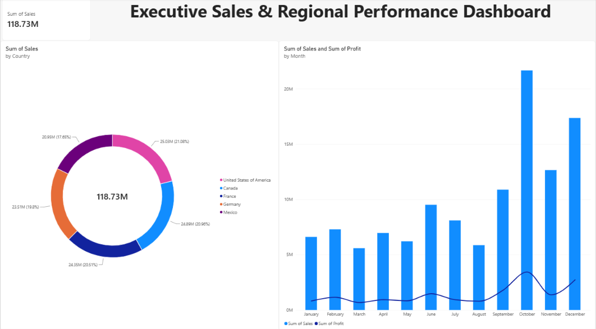

# 📊 Enterprise Business Intelligence Suite (DA-01)
### Multi-Region Commercial Sales & Margin Analytics


---

## 📌 Executive Dashboard
Consolidating global sales performance, regional distribution, and monthly revenue run-rates across 5 international commercial territories.



---

## 💼 Business Problem & Objective
* **Fragmentation:** Regional operating teams relied on siloed, manual spreadsheets, creating a 7-day reporting lag for leadership.
* **Objective:** Architect a centralized Power BI dashboard with Kimball Star Schema dimensional modeling to track **$118.73M** in gross commercial revenue and profitability in real time.

---

## 📈 Strategic Business Findings

| Territory / Metric | Performance Volume | Revenue Share (%) | Operational Insight |
| :--- | :--- | :--- | :--- |
| **United States** | **$25.03M** | **21.08%** | Primary revenue driver across enterprise accounts |
| **Canada** | **$24.89M** | **20.96%** | High consistency with strong reseller margins |
| **France** | **$24.35M** | **20.51%** | Core European hub with solid month-over-month volume |
| **Germany** | **$23.51M** | **19.80%** | Steady commercial pipeline with low variance |
| **Mexico** | **$20.95M** | **17.65%** | Rapidly growing territory with seasonal fluctuations |

> **Key Trend:** Global sales saw steady baseline performance across Q1–Q3 ($6M–$9M/month), culminating in an aggressive Q4 commercial surge peaking in October at **>$21.8M**.

---

## 🏗️ Data Architecture & Modeling
* **Kimball Star Schema:** Centralized `FactResellerSales` fact table connected to conformed dimensions (`DimGeography`, `DimDate`, `DimProduct`) via 1-to-many relationships.
* **ETL Pipeline:** Power Query automated transformations for currency normalization, null handling, and surrogate key assignment.
* **Governance:** Optimized under VertiPaq tabular storage for sub-second visual slicing and cross-filtering.

---

## 🧮 Core DAX Measures

```dax
// Total Gross Revenue
Total Sales = SUM(FactResellerSales[ExtendedAmount])

// Gross Operating Profit
Total Profit = SUM(FactResellerSales[GrossProfit])

// Gross Margin Percentage
Gross Margin % = DIVIDE([Total Profit], [Total Sales], 0)

// Time Intelligence: Year-to-Date Revenue
Sales YTD = TOTALYTD([Total Sales], DimDate[FullDate])
